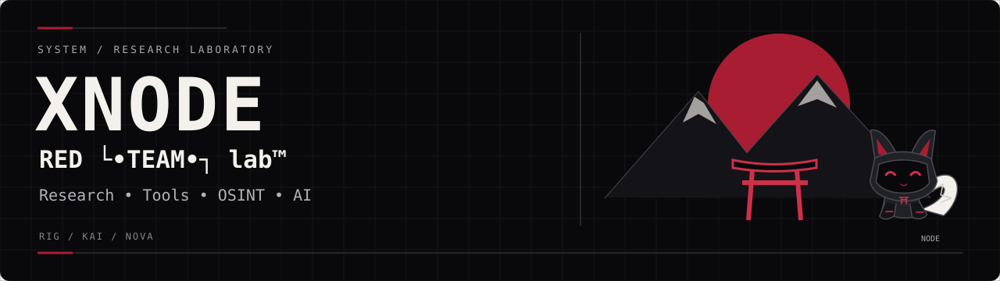

<p align="center"></p>

[Штаб лаборатории](https://github.com/Xnode-sh) · [Профиль XNODE](https://github.com/Xnode-sh)

# labnet — своя сеть поверх своего канала

**Свои узлы, свои имена, свои ключи. Без root, без облака, без чужого сервера.**

`labnet` превращает любой общий каталог — Syncthing-папку, SSH-монт, флешку, сетевую шару —
в приватную сеть между нашими устройствами. Каждый узел получает имя и ключ;
сообщения адресуются по имени, шифруются общим ключом сети и подписываются отправителем.


## Зачем

Телефон и сервер за NAT не видят друг друга напрямую, а без root не поднять ни туннель,
ни точку доступа. Но у нас уже есть общий канал — папка, которую синхронизирует Syncthing
или монтирует SSH. `labnet` кладёт зашифрованные конверты в этот канал и забирает их оттуда.
Транспорт не наш — содержимое наше.

## Модель

| Слой | Реализация |
|---|---|
| Идентичность узла | Ed25519-ключ, `node_id` = `sha256(pub)[:12]` |
| Ключ сети | scrypt(пароль, соль от имени сети) → 32 байта |
| Шифр | AES-256-GCM (конверт), AAD = имя сети |
| Подпись | Ed25519 над каноничным JSON конверта |
| Ростер | самоподписанные записи узлов в общем канале |
| Транспорт | каталог `channel/` (любой общий) |

Подделка конверта не проходит проверку подписи; чужой ключ сети не расшифрует содержимое.

## Установка

```bash
pkg install python python-cryptography
git clone https://github.com/Xnode-sh/labnet.git
cd labnet
```

## Быстрый старт

На первом узле (например, телефон):

```bash
export LABNET_PASSPHRASE='пароль сети'
python labnet.py --share ~/labnet-share init --name freya --net redlab
python labnet.py announce
```

На втором узле (сервер) — та же сеть и пароль, свой канал (общая папка):

```bash
export LABNET_PASSPHRASE='пароль сети'
python labnet.py --share /srv/lab/share/labnet init --name acer --net redlab
python labnet.py announce
python labnet.py peers
```

Обмен:

```bash
python labnet.py send acer "привет из лаборатории"   # имя / node_id / all
python labnet.py recv
python labnet.py ping acer
python labnet.py serve                                # отвечать на ping
```

## Храни-и-передай (store-and-forward)

Сообщение не теряется, даже если адресат оффлайн:

- исходящие лежат в **durable outbox**, пока адресат не подтвердит (`ack`);
- `labnet queue` — что ждёт; `labnet flush` — повторить отправку;
- **relay**: конверт для C может проехать через B (`send ... --via B`), TTL ограничен;
- защита от дублей: конверт обрабатывается один раз.

## Живая сеть (M2)

```bash
labnet card --role engineering     # своя визитка (ник, роль, уровень знаний)
labnet discover --seconds 3        # поиск узлов в локальной сети (UDP-маяки)
labnet listen --port 47112         # принимать сессии
labnet connect 192.168.0.50:47112  # подключиться к узлу
```

На рукопожатии узлы доказывают, что у обоих **тот же ключ сети** (HMAC-транскрипт,
сам ключ не передаётся), обмениваются **подписанными визитками** и — на телефоне с
Termux:API — **вибрируют позывным**. После знакомства идёт обмен очередью.

## Канал (транспорт)

Каналом служит каталог `<share>/<net>/`:

```
labnet/redlab/
├── roster/<node_id>.json              # кто в сети (самоподпись)
└── inbox/<node_id>/<ts>-<from>.json   # зашифрованные конверты
```

Варианты канала:
- **Syncthing** — направь `--share` в общую папку `LAB-SHARE`.
- **SSH-монт** — `sshfs` или `rsync` по cron.
- **Флешка** — для разовой переноски между изолированными машинами.

## Автономный режим

```bash
bash run/serve-loop.sh          # принимает сообщения и отвечает на ping
```

Или в cron: `*/1 * * * * cd ~/labnet && python labnet.py recv`.

## Безопасность

- Приватный ключ узла — `~/.config/labnet/identity.json`, права `600`, в git не попадает.
- Пароль сети не хранится: берётся из `LABNET_PASSPHRASE` или вводится интерактивно.
- Канал можно держать на чужом диске (Syncthing) — конверты уже зашифрованы и подписаны.
- Ростер публичен для тех, у кого есть канал: видны имена, `node_id` и hostname. Тексты — нет.

## Ограничения

- Это оверлей «храни-и-передай» поверх готового канала, а не L2/L3. Задержка — как у канала.
- `ping` измеряет время доставки через канал, а не сетевой RTT.
- Нет группового ключа на сообщение: все узлы сети имеют общий ключ шифрования (ротация — смена пароля сети).

## Тесты

```bash
python -m unittest discover -s tests -v
```

## Лицензия

MIT © 2026 Xnode-sh — RED └•TEAM•┐ lab™
